 

## `> whoami`

I'm a **Mechanical Engineering graduate**, a **Networking Engineer by trade** (Azure), and an **aspiring Data & Machine Learning Scientist** learning every skill I can to change the world with AI.

Every project here is built from the ground up: planning, designing, and solving real-world problems end to end.

🎓 **Post Graduate Degree in Data Science & Analytics**, UT Austin McCombs School of Business
📍 Texas · 🏢 Microsoft

## `> ls ./projects`

### 🌐 Web builds

| Project | What it is | Stack |
|---|---|---|
| **[smart-cubic-demo](https://github.com/RayVazcari/smart-cubic-demo)** | Bilingual (EN/ES) marketing site for a San Antonio water-restoration company, deployed on GitHub Pages |    |
| **[somos-career-journey](https://github.com/RayVazcari/somos-career-journey)** | Concept prototype of a career-journey experience with a live demo |  |

### 🧠 Data science & machine learning

| Project | Technique | Problem solved |
|---|---|---|
| **[LinearRegression · ReCell](https://github.com/RayVazcari/LinearRegressionModel-ReCell-Project)** | Linear regression | Predicting normalized used-phone prices |
| **[AB-Testing · E-News](https://github.com/RayVazcari/AB-Testing-E-news-Project)** | EDA · hypothesis testing | Measuring what drives engagement on a news platform |
| **[SupervisedLearning · INN Hotels](https://github.com/RayVazcari/SupervisedLearning-Classification-INNHotels-Project)** | Classification | Predicting hotel booking behavior |
| **[EnsembleTechniques · EasyVisa](https://github.com/RayVazcari/EnsembleTechniques-EasyVisa-Project)** | Ensemble methods | Predicting visa approval likelihood |
| **[ModelTuning · ReneWind](https://github.com/RayVazcari/ModelTuning-ReneWind-Project)** | Model tuning | Detecting mechanical failures in wind generators |
| **[UnsupervisedLearning · Trade&Ahead](https://github.com/RayVazcari/UnsupervisedLearning-TradeAhead-Project)** | Clustering | Cluster analysis on stock data |
| **[EDA · Food Hub](https://github.com/RayVazcari/EDA-Food-Hub-Project)** | Exploratory analysis | Understanding food-delivery demand |

### 🎯 Challenges

- **[SQL Advent Calendar 2025](https://github.com/RayVazcari/SQL-Advent-Calendar-2025)**: 24 days of SQL challenges for data scientists
- **[Python Summer Party 2025](https://github.com/RayVazcari/Python-Summer-Party-2025)**: 15-day Python challenge for data scientists

## `> cat ./stack`

 

**Core skills:** `Exploratory Data Analysis` · `Hypothesis Testing` · `Linear & Logistic Regression` · `Supervised Learning` · `Ensemble Methods` · `Model Tuning` · `Unsupervised Learning`

## `> status --in-progress`

| 🔭 Certifications & courses | 🌱 Currently learning |
|---|---|
| [Azure Data Fundamentals (DP-900)](https://learn.microsoft.com/en-us/credentials/certifications/azure-data-fundamentals/) | Azure Machine Learning Studio |
| [Azure Data Scientist Associate (DP-100)](https://learn.microsoft.com/en-us/credentials/certifications/azure-data-scientist/) | Machine Learning & Deep Learning |
| [Machine Learning Specialization](https://www.coursera.org/specializations/machine-learning-introduction) | SQL |
| [Deep Learning Specialization](https://www.coursera.org/specializations/deep-learning) | R |
| [DeepLearning.AI Data Engineering](https://www.coursera.org/professional-certificates/data-engineering) | C#, Bash, Linux |
| [Generative AI for Software Development](https://www.coursera.org/professional-certificates/generative-ai-for-software-development) | AWS, Azure SQL |
| [ChatGPT Prompt Engineering for Developers](https://www.deeplearning.ai/short-courses/chatgpt-prompt-engineering-for-developers/) | |

## `> stats --live`

### 🐍 Contribution snake

<picture>
  <source media="(prefers-color-scheme: dark)" srcset="https://raw.githubusercontent.com/RayVazcari/RayVazcari/output/github-snake-dark.svg" />
  
</picture>

**Data Craftsman · Business Scientist · Bouldering Novice**

